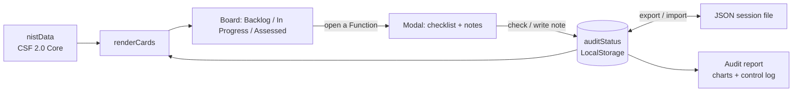

# 🛡️ NIST Sentinel: CSF 2.0 Audit Support Tool

<p align="center">
  
</p>

<p align="center">
  <a href="https://kaledsml.github.io/nist-sentinel/">
    
  </a>
  <a href="https://www.youtube.com/watch?v=MbYpAKBpVT4">
    
  </a>
  
</p>

**NIST Sentinel** is a browser-based tool that turns the **NIST Cybersecurity Framework (CSF) 2.0** into a visual audit checklist: track each control, attach notes as evidence, see progress per Function, and export an audit report.

> **Status:** v1.0 working prototype for audit support. Findings must be validated by a qualified information security auditor.

---

## 💡 Why I built it

During my internal audit internship I saw how framework-based audits were tracked in spreadsheets: hard to see progress at a glance, hard to share, and easy to lose context. I built Sentinel to explore a lighter alternative that keeps the audit data on the auditor's own machine.

---

## 🚀 What it does

- **Full CSF 2.0 Core:** the six Functions (Govern, Identify, Protect, Detect, Respond, Recover) with their categories and subcategories.
- **Board view:** each Function appears as a card in **Backlog / In Progress / Assessed**, placed automatically according to how many of its controls are checked.
- **Control checklist with notes:** open a Function, check controls as implemented and write audit notes per control.
- **Progress tracking:** per-Function and global completion percentages.
- **Export / import sessions:** save your audit as a JSON file and resume it later or on another device.
- **Audit report:** a printable report with a radar chart (balance across Functions), a bar chart (implementation %) and a detailed control log with your notes, ready to save as PDF.
- **Light and dark mode.**

---

## 🔒 Privacy and data handling

- **No backend, no accounts, no analytics.** Everything is processed in your browser.
- **Where data lives:** progress and notes are saved in the browser's `LocalStorage` on your device, and nowhere else.
- **Treat exports as sensitive:** the JSON session file is plain text and unencrypted. Store and share it accordingly.
- **Third-party libraries:** Tailwind CSS, Chart.js, SortableJS and the Inter font are loaded from public CDNs, so the first load needs an internet connection. Fully offline use would require bundling them locally (see roadmap).

---

## 🏗️ How it works



**Stack:** HTML, vanilla JavaScript, Tailwind CSS (CDN), Chart.js, SortableJS.

---

## 🔧 Run it

Open the **[live demo](https://kaledsml.github.io/nist-sentinel/)**, or clone and open locally:

```bash
git clone https://github.com/KaledSML/nist-sentinel.git
cd nist-sentinel
# open index.html in a modern browser
```

---

## 🧭 Known limitations and roadmap

- [ ] Bundle all libraries locally (with integrity checks) for true offline use.
- [ ] Harden session import: strict schema validation and output escaping for notes.
- [ ] Optional encrypted export (passphrase-based, Web Crypto API).
- [ ] Maturity levels per control instead of a single implemented / not assessed state.
- [ ] Drag-and-drop status changes (today the board groups cards automatically).
- [ ] Automated tests.

---

## 📄 License

MIT. See [LICENSE](LICENSE).

Built by [@kaledsml](https://github.com/kaledsml) 🐯
