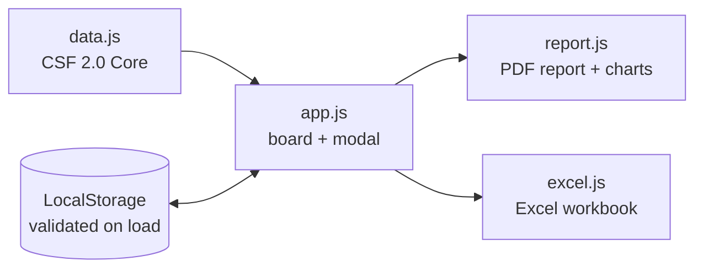

# 🛡️ NIST Sentinel: CSF 2.0 Audit Support Tool

<p align="center">
  
</p>

<p align="center">
  <a href="https://kaledsml.github.io/nist-sentinel/">
    
  </a>
  <a href="https://www.youtube.com/watch?v=MbYpAKBpVT4">
    
  </a>
  
  
</p>

**NIST Sentinel** is a browser-based tool that turns the **NIST Cybersecurity Framework (CSF) 2.0** into a visual audit checklist. Define your audit scope, set a status for each control, attach notes as evidence, track progress per Function, and export the results as a PDF report or an Excel workbook.

> **Status:** working prototype for audit support. Findings must be validated by a qualified information security auditor.

---

## 💡 Why I built it

During my internal audit internship I saw how framework-based audits were tracked in spreadsheets: hard to see progress at a glance, hard to share, and easy to lose context. I built Sentinel to explore a lighter alternative that keeps the audit data on the auditor's own machine.

---

## 🚀 What it does

- **Full CSF 2.0 Core:** the six Functions (Govern, Identify, Protect, Detect, Respond, Recover) with their categories and subcategories.
- **Four statuses per control:** Not Started, In Progress, Implemented and Not Applicable.
- **Audit scope:** include or exclude individual controls, or a whole category at once. Out-of-scope controls never count toward any percentage.
- **Audit notes:** write evidence or comments per control.
- **Audit details:** optional audited area, auditor name and date, shown in the report and the Excel file.
- **Board view:** each Function appears as a card in **Backlog / In Progress / Assessed**, placed automatically from its progress.
- **Progress tracking:** per-category, per-Function and global percentages.
- **PDF report:** a printable report with a radar chart (balance across Functions), a bar chart (implementation %) and a control log grouped by status, with your notes. Use *Export PDF* and save from the print dialog.
- **Excel export:** a workbook with a *Checklist* sheet (one control per row, with status and notes) and a *Summary* sheet (audit details and counts per Function).
- **Light and dark mode.**

### How progress is calculated

| Status | Effect on the percentage |
|---|---|
| Implemented | Counts as done |
| In Progress | Counts in the total, but not as done |
| Not Started | Counts in the total |
| Not Applicable | Removed from the total |
| Out of scope | Ignored completely |

The board, the PDF report and the Excel file all use the same calculation, so they never contradict each other.

---

## 🔒 Privacy and data handling

- **No backend, no accounts, no analytics, no network requests.** Everything runs in your browser.
- **Fully local:** all libraries (Chart.js, SortableJS, ExcelJS) are bundled in `vendor/`, Tailwind CSS is compiled into `tailwind.css`, and the interface uses system fonts. Nothing is loaded from a CDN, so the app works offline once the page is open.
- **Where data lives:** progress, scope, notes and audit details are saved in your browser's `LocalStorage`, on your device only.
- **Not encrypted:** `LocalStorage` is plain text. Anyone with access to your browser profile can read it. Use a private device and clear the data when you finish a sensitive audit.
- **Treat exports as sensitive:** the PDF and Excel files contain your notes in plain text. Store and share them accordingly.

---

## 🧱 Security measures

- **Content Security Policy** (via `<meta>`): scripts can only come from the site's own files (`script-src 'self'`), and plugins are blocked (`object-src 'none'`).
- **No inline event handlers.** Buttons use `data-action` attributes and a single event listener, which is what makes a strict script policy possible.
- **Validated on load:** stored data is filtered against the list of valid control codes, an allow-list of statuses, maximum text lengths and a strict date check. Anything unexpected is ignored.
- **Escaped output:** notes and audit details are HTML-escaped before being rendered in the app and in the report.
- **Spreadsheet formula protection:** in the Excel export, user-written text starting with `=`, `+`, `-` or `@` gets a leading apostrophe. This is a defense in depth; ExcelJS already stores these values as text. The apostrophe is visible in the cell.
- **External links** use `rel="noopener noreferrer"`.

Known gaps are listed in the roadmap below. To report a vulnerability, please open an issue or contact me through my GitHub profile.

---

## 🏗️ How it works



**Stack:** HTML, vanilla JavaScript, Tailwind CSS (compiled locally), Chart.js, SortableJS, ExcelJS.

---

## 🔧 Run it

Open the **[live demo](https://kaledsml.github.io/nist-sentinel/)**, or clone and open locally:

```bash
git clone https://github.com/KaledSML/nist-sentinel.git
cd nist-sentinel
# open index.html in a modern browser
```

No install step is needed. The compiled `tailwind.css` is already in the repo. To rebuild it after changing styles, see `LEEME-BUILD.txt`.

---

## 🧭 Known limitations and roadmap

- [ ] Remove inline styles so the CSP can drop `'unsafe-inline'` from `style-src`.
- [ ] Record the version and SHA-256 hash of each file in `vendor/`.
- [ ] Session backup: export and import the audit as JSON, with strict schema validation.
- [ ] Optional encrypted storage and export (passphrase-based, Web Crypto API).
- [ ] Maturity levels per control.
- [ ] Make drag-and-drop on the board change statuses (today the board groups cards automatically, so dragging is visual only).
- [ ] Automated tests.
- [ ] `frame-ancestors` protection (not possible through `<meta>` on GitHub Pages).

---

## 📄 License

MIT. See [LICENSE](LICENSE).

Built by [@kaledsml](https://github.com/kaledsml) 🐯
